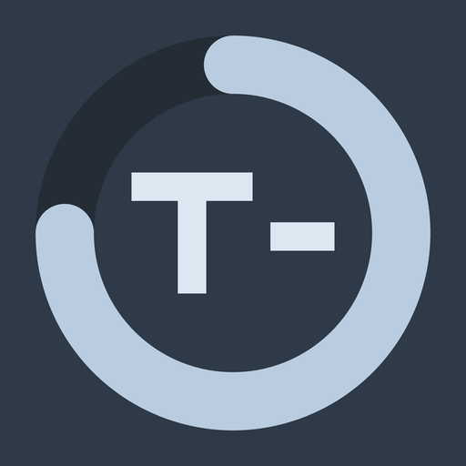
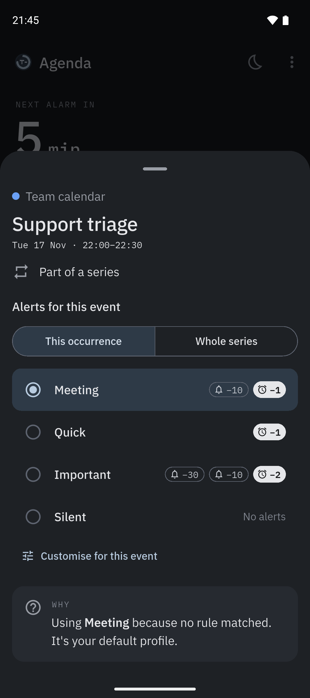
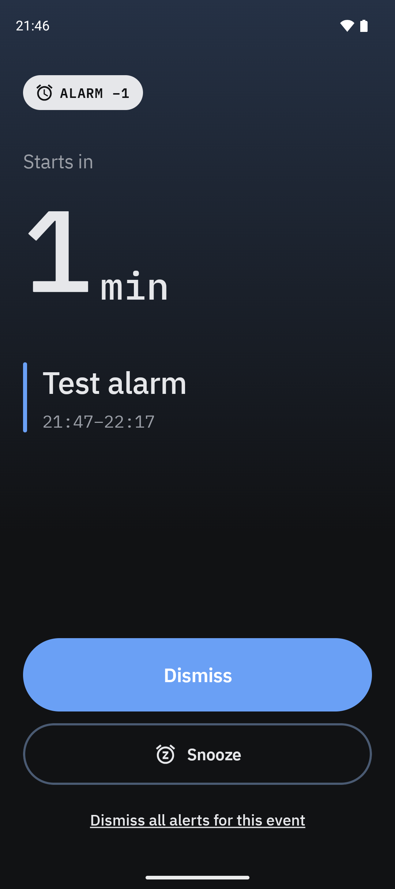
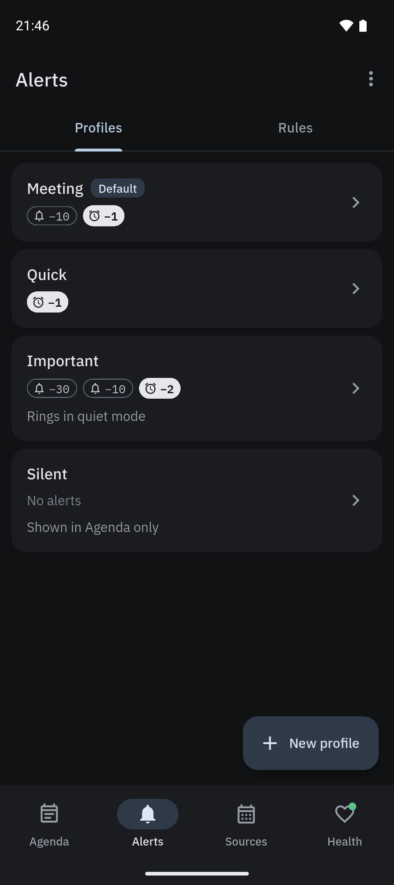
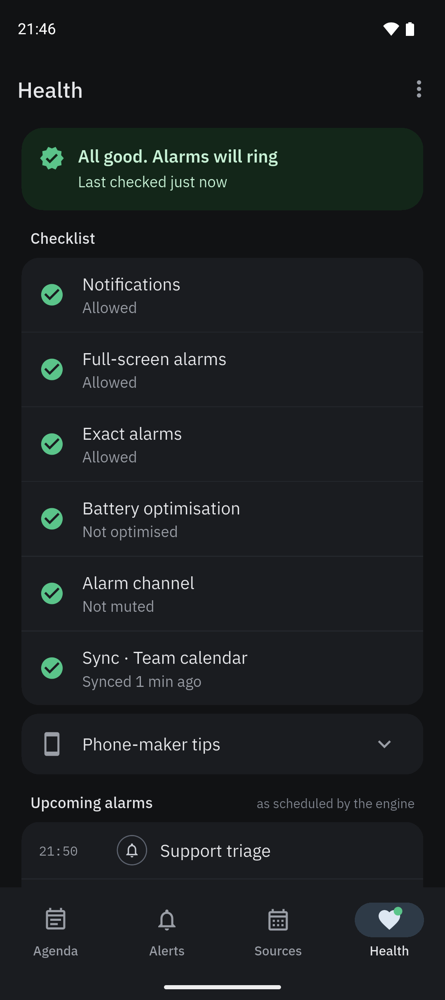
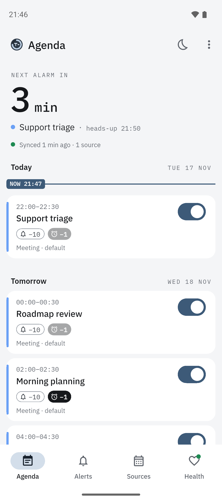

  

<h1 align="center">T-Minus: Meeting Alarm</h1>

<b>Meeting alarms you can't miss, for Outlook, Teams and phone calendar meetings.</b>

  
  
  

  <a href="https://fifothehein.github.io/tminus/"><b>Website</b></a>
  &nbsp;&middot;&nbsp;
  <a href="#join-the-alpha-test"><b>Join the Alpha test</b></a>
  &nbsp;&middot;&nbsp;
  <a href="https://fifothehein.github.io/tminus/privacy/"><b>Privacy policy</b></a>
  &nbsp;&middot;&nbsp;
  <a href="https://github.com/FifoTheHein/tminus/issues"><b>Report a problem</b></a>

  

  
  
  
  

  
  
  
  

T-Minus turns your calendar meetings into alarms you can't miss, and can always stop. Out of the box, every meeting gets a heads-up 10 minutes before and an alarm 1 minute before.

## Join the Alpha test

T-Minus is in a closed test on Google Play, and anyone can join. Use the Google account that your phone's Play Store uses for every step.

| Step | What to do |
|:---:|---|
| **1** | Join the [t-minus-testers group](https://groups.google.com/g/t-minus-testers). You are let in straight away, with no approval. |
| **2** | Open the [opt-in page](https://play.google.com/apps/testing/io.github.fifothehein.tminus) on your phone, or on a computer signed in to the same account, and tap **Become a tester**. |
| **3** | Install [T-Minus from Google Play](https://play.google.com/store/apps/details?id=io.github.fifothehein.tminus). |

> [!NOTE]
> After you join the group, it can take a few minutes before the opt-in page lets you in. If it says you can't join yet, wait a little and try again.

> [!TIP]
> Please keep T-Minus installed for at least 14 days: Google needs that from testers before the app can be released to everyone. T-Minus needs Android 8 or later. Report problems and ideas in [GitHub issues](https://github.com/FifoTheHein/tminus/issues), and leave the group at any time to stop testing.

## What it does

<table>
<tr>
<td width="50%" valign="top">

### 📅 Add your calendars

- Pick a calendar already on your phone, for example from a Google, Samsung, Outlook or Exchange account, or paste a calendar link (Outlook, Google Calendar or any ICS link).
- Teams meetings come in through your calendar, for example Outlook.
- A meeting with a Teams, Google Meet, Zoom or Webex link gets a Join button. On a phone calendar, T-Minus finds the link when it is written in the meeting's description or location.
- Calendars are checked about every 15 minutes, and again shortly before each alarm.

</td>
<td width="50%" valign="top">

### 🔔 Alerts that get stronger

- A heads-up notification first, then a full-screen alarm on the alarm volume.
- Out of the box: a heads-up 10 minutes before, an alarm 1 minute before.
- Meeting, Quick, Important and Silent profiles, or make your own.
- Keyword rules pick a profile by a meeting's title, organiser and more.
- All-day, free, tentative and cancelled meetings, and meetings you declined in a phone calendar, are skipped unless you change that.

</td>
</tr>
<tr>
<td valign="top">

### 🌙 Quiet when you need it

- Mute today, Pause or Vacation, plus a Mute today tile for quick settings.
- Meetings on the Important profile still ring during Mute today and Pause.

</td>
<td valign="top">

### ✋ Always a way to stop

- Stop from the notification or the alarm screen. On the alarm screen, the volume keys stop it too.
- Snooze for 1 or 5 minutes, until 1 minute before, or until the meeting starts.

</td>
</tr>
<tr>
<td valign="top">

### 🔍 Know why it will or won't ring

- Every meeting shows its alerts and why.
- A meeting found in two calendars rings once.
- The Health tab checks permissions, battery settings and sync, and lists your next alarms.

</td>
<td valign="top">

### 🔒 Private

- No account, no ads, no analytics. Your calendar stays on your phone.
- Calendar links are stored encrypted and never backed up.
- T-Minus uses the internet only to fetch the calendar links you add.
- Read the [privacy policy](https://fifothehein.github.io/tminus/privacy/).

</td>
</tr>
</table>

## Availability

T-Minus is in a closed test on Google Play (version 1.0.2, 20 November 2026). It is not on the public Play Store yet. To try it, see [Join the Alpha test](#join-the-alpha-test).

Bugs and questions go to [GitHub issues](https://github.com/FifoTheHein/tminus/issues). The [website](https://fifothehein.github.io/tminus/) and [the privacy policy](https://fifothehein.github.io/tminus/privacy/) are on GitHub Pages.

## Support

T-Minus has no ads, no subscriptions and no tracking. If it gets you to your meetings on time, you can [☕ buy me a coffee](https://buymeacoffee.com/fifothehein).

Outlook and Teams are trademarks of Microsoft. Google Calendar, Google Meet and Google Play are trademarks of Google. Zoom and Webex are trademarks of their owners. T-Minus is an independent app and is not affiliated with or endorsed by Microsoft, Google or the owners of Zoom and Webex.
